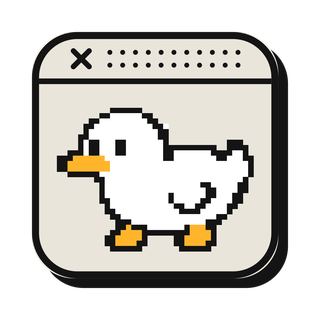
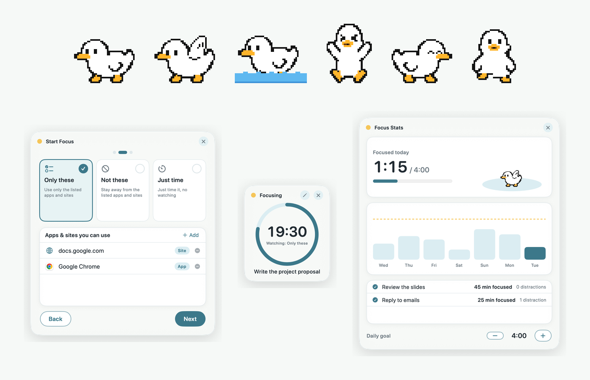

<h1 align="center">DuckDesk</h1>

デスクトップにドット絵のアヒルが住む、Mac 用の小さなアプリ。 
A tiny pixel duck that lives on your Mac desktop. 
Chú vịt pixel nhỏ sống trên màn hình Mac của bạn.

<a href="#日本語">日本語</a> · <a href="#english">English</a> · <a href="#tiếng-việt">Tiếng Việt</a>

---

## 日本語

### できること

- アヒルがカーソルを目で追い、キーを打つと羽をぱたぱた、スクロールすると水に浮かんで泳ぎます
- クリックすると鳴き、掴むと足をばたばたさせ、しばらく操作しないと眠ります
- ストレッチと水分補給のお知らせ、ポモドーロ（25分の作業と5分の休憩をくり返す時間の区切り方）のタイマー
- **集中モード**：やることを1つ決めて時間を計ります。使ってよいアプリやサイトを決めておくと、ほかのものを開いたときにアヒルが注意してくれます（アプリを止めたり閉じたりはしません）
- **Claude Code との連携**：Claude Code（Anthropic の AI コーディングツール）が考えている間は考え顔になり、作業が終わると跳ねて鳴きます
- 日本語・English・Tiếng Việt に対応

### 動く環境

macOS 13 以降。Apple 製チップと Intel 製チップの両方に対応しています。

### 入れ方

1. [Releases](../../releases/latest) から `DuckDesk-0.1.1.zip` をダウンロードして開きます
2. 出てきた `DuckDesk.app` を「アプリケーション」フォルダに移します
3. `DuckDesk.app` を開きます。初回は「開けません」という警告が出ます
4. 「システム設定」→「プライバシーとセキュリティ」を開き、下の方にある「このまま開く」を押します

警告が出るのは、このアプリが Apple の公証（Apple が配布前にアプリを確認する仕組み）を受けていないためです。個人が無料で配っているアプリのため、公証は受けていません。

起動するとメニューバーに 🦆 が出ます。設定や終了はここから行います。

ダウンロードしたファイルが本物かを確かめたいときは、ターミナル（Mac に入っている、文字でコマンドを打つアプリ）で `shasum -a 256 DuckDesk-0.1.1.zip` を実行し、Releases に書いてある値と一致するかを見てください。このページ以外から入手した zip は使わないでください。

新しい版に入れ替えたあとは、アクセシビリティなどの許可が外れることがあります。そのときは許可を付け直してください。

### 許可について（どれも任意）

| 許可 | 何に使うか |
|---|---|
| アクセシビリティ | キーを打ったことに反応するため。打った文字は読みも記録もしません |
| 自動操作（Chrome・Arc・Brave・Edge） | 集中モードでサイトを見張るとき、開いているページの URL を読むため。ページは操作しません |

許可しなくても、ほかの機能は使えます。

### 画面の点滅について

集中モードでよそ見が30秒続くと、画面全体が赤く点滅します（1回のよそ見で最大3回）。光の点滅が苦手な方は、メニューバーの 🦆 →「よそ見で画面を点滅させる」をオフにしてください。Mac の「視差効果を減らす」がオンのときは、点滅しません。

### プライバシー

- インターネットには一切つながりません。何も送信しません
- 集中の記録は、この Mac の `~/Library/Application Support/DuckDesk/` にだけ保存されます

### Claude Code との連携

メニューバーの 🦆 →「Claude Code と連携…」→「設定をコピー」を押し、`~/.claude/settings.json` の `"hooks"` の中に貼り付けます。先に `DuckDesk.app` を「アプリケーション」フォルダに移してから設定してください。

### 消し方

1. メニューバーの 🦆 →「終了」
2. `DuckDesk.app` をゴミ箱に入れます
3. 記録も消す場合は `~/Library/Application Support/DuckDesk/` をゴミ箱に入れます
4. Claude Code と連携していた場合は、`~/.claude/settings.json` から DuckDesk の設定を消します

### 利用条件

- 個人でも仕事でも、無料で使えます
- このアプリ（zip を含む）を再配布・販売することはできません。配布したいときは、このページのリンクを共有してください
- 無保証です。このアプリを使ったことで生じたいかなる損害についても、作者は責任を負いません

---

## English

### What it does

- The duck follows your cursor with its eyes, flaps its wings while you type, and floats and paddles when you scroll
- Click it to hear a quack, grab it and it kicks its feet, leave it alone and it falls asleep
- Stretch and water reminders, plus a Pomodoro timer (25 minutes of work, 5 minutes of rest)
- **Focus mode**: pick one task and a time. If you choose which apps and sites you'll use, the duck warns you when you wander off (it never blocks or closes anything)
- **Claude Code integration**: the duck makes a thinking face while Claude Code (Anthropic's AI coding tool) works, and hops with a quack when it's done
- Available in 日本語, English and Tiếng Việt

### Requirements

macOS 13 or later. Runs on both Apple silicon and Intel Macs.

### Install

1. Download `DuckDesk-0.1.1.zip` from [Releases](../../releases/latest) and open it
2. Move `DuckDesk.app` into your Applications folder
3. Open `DuckDesk.app`. The first time, macOS says it can't be opened
4. Go to System Settings → Privacy & Security, scroll down and click "Open Anyway"

You see this warning because the app isn't notarized (Apple's pre-distribution check). It's a free app made by an individual, so it hasn't been notarized.

Once it's running, a 🦆 appears in the menu bar. Settings and Quit are there.

To check that your download is genuine, run `shasum -a 256 DuckDesk-0.1.1.zip` in Terminal and compare the result with the value listed on the Releases page. Don't use zips from anywhere other than this page.

After updating to a new version, permissions such as Accessibility may be reset. If so, grant them again.

### Permissions (all optional)

| Permission | Why |
|---|---|
| Accessibility | To react when you type. It never reads or records what you type |
| Automation (Chrome, Arc, Brave, Edge) | To read the URL of the open page when focus mode watches sites. It never controls the page |

Everything else works without them.

### Screen flashing

If you stay distracted for 30 seconds in focus mode, the whole screen flashes red (at most 3 times per distraction). If flashing light bothers you, turn off 🦆 → "Flash Screen When Distracted". It never flashes when "Reduce motion" is on in your Mac's settings.

### Privacy

- The app never connects to the internet and sends nothing
- Focus records are stored only on your Mac, in `~/Library/Application Support/DuckDesk/`

### Connect Claude Code

Click 🦆 in the menu bar → "Connect Claude Code…" → "Copy Settings", then paste it inside `"hooks"` in `~/.claude/settings.json`. Move `DuckDesk.app` to the Applications folder before you do this.

### Uninstall

1. Click 🦆 in the menu bar → "Quit"
2. Move `DuckDesk.app` to the Trash
3. To remove your records too, move `~/Library/Application Support/DuckDesk/` to the Trash
4. If you connected Claude Code, remove the DuckDesk entries from `~/.claude/settings.json`

### Terms of use

- Free to use, personally or at work
- You may not redistribute or sell this app (including the zip). To share it, share a link to this page
- Provided as is, without warranty. The author is not liable for any damage arising from its use

---

## Tiếng Việt

### Chức năng

- Chú vịt nhìn theo con trỏ chuột, vỗ cánh khi bạn gõ phím, và nổi trên mặt nước, đạp chân khi bạn cuộn trang
- Nhấp vào thì vịt kêu, kéo lên thì vịt đạp chân, để yên một lúc thì vịt ngủ
- Nhắc vươn vai và uống nước, cùng đồng hồ Pomodoro (làm 25 phút, nghỉ 5 phút)
- **Chế độ tập trung**: chọn một việc cần làm và thời gian. Nếu bạn chọn trước các ứng dụng và trang web được dùng, vịt sẽ nhắc khi bạn mở thứ khác (vịt không chặn hay đóng gì cả)
- **Kết nối Claude Code**: khi Claude Code (công cụ lập trình AI của Anthropic) đang xử lý, vịt làm mặt suy nghĩ; xong việc thì nhảy lên và kêu
- Hỗ trợ 日本語, English và Tiếng Việt

### Yêu cầu

macOS 13 trở lên. Chạy được trên cả máy Mac dùng chip Apple và chip Intel.

### Cài đặt

1. Tải `DuckDesk-0.1.1.zip` từ [Releases](../../releases/latest) rồi mở ra
2. Chuyển `DuckDesk.app` vào thư mục Applications
3. Mở `DuckDesk.app`. Lần đầu macOS sẽ báo không thể mở
4. Vào Cài đặt hệ thống → Quyền riêng tư & Bảo mật, kéo xuống và nhấn "Vẫn mở"

Cảnh báo này xuất hiện vì ứng dụng chưa được Apple công chứng (notarization — bước Apple kiểm tra ứng dụng trước khi phát hành). Đây là ứng dụng miễn phí do cá nhân làm, nên chưa được công chứng.

Khi chạy, biểu tượng 🦆 sẽ xuất hiện trên thanh menu. Cài đặt và Thoát nằm ở đó.

Để kiểm tra tệp tải về là bản gốc, hãy chạy `shasum -a 256 DuckDesk-0.1.1.zip` trong Terminal và so sánh với giá trị ghi trên trang Releases. Không dùng tệp zip lấy từ nơi khác ngoài trang này.

Sau khi cập nhật lên phiên bản mới, các quyền như Trợ năng có thể bị đặt lại. Khi đó hãy cấp lại quyền.

### Quyền truy cập (đều không bắt buộc)

| Quyền | Dùng để |
|---|---|
| Trợ năng (Accessibility) | Phản ứng khi bạn gõ phím. Không đọc hay ghi lại nội dung bạn gõ |
| Tự động hóa (Chrome, Arc, Brave, Edge) | Đọc URL của trang đang mở khi chế độ tập trung theo dõi trang web. Không điều khiển trang |

Không cấp quyền thì các chức năng khác vẫn dùng được.

### Về việc nháy màn hình

Ở chế độ tập trung, nếu bạn xao nhãng liên tục 30 giây, toàn bộ màn hình sẽ nháy đỏ (tối đa 3 lần cho mỗi lần xao nhãng). Nếu bạn nhạy cảm với ánh sáng nhấp nháy, hãy tắt 🦆 → "Nháy màn hình khi xao nhãng". Khi bật "Giảm chuyển động" trong cài đặt Mac, màn hình sẽ không nháy.

### Quyền riêng tư

- Ứng dụng không kết nối internet và không gửi bất cứ thứ gì
- Dữ liệu tập trung chỉ được lưu trên máy Mac của bạn, tại `~/Library/Application Support/DuckDesk/`

### Kết nối Claude Code

Nhấp 🦆 trên thanh menu → "Kết nối Claude Code…" → "Sao chép cài đặt", rồi dán vào trong `"hooks"` của `~/.claude/settings.json`. Hãy chuyển `DuckDesk.app` vào thư mục Applications trước khi làm bước này.

### Gỡ cài đặt

1. Nhấp 🦆 trên thanh menu → "Thoát"
2. Chuyển `DuckDesk.app` vào Thùng rác
3. Nếu muốn xóa cả dữ liệu, chuyển `~/Library/Application Support/DuckDesk/` vào Thùng rác
4. Nếu đã kết nối Claude Code, hãy xóa phần cài đặt DuckDesk trong `~/.claude/settings.json`

### Điều khoản sử dụng

- Miễn phí cho cá nhân và công việc
- Không được phân phối lại hay bán ứng dụng này (kể cả tệp zip). Muốn chia sẻ, hãy gửi đường dẫn đến trang này
- Ứng dụng được cung cấp nguyên trạng, không bảo hành. Tác giả không chịu trách nhiệm cho bất kỳ thiệt hại nào phát sinh từ việc sử dụng

---

© 2026 Taiga Seike
